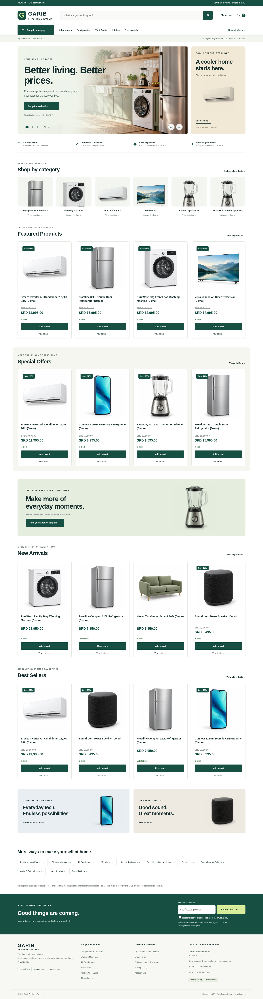

# Garib Appliance World

An original, responsive WordPress/WooCommerce appliance store for Suriname. Prices use **SRD**. Checkout supports **cash on delivery** and **direct bank transfer**. Hosting is not configured.



## Local development

On Windows, follow the [Windows + Docker Desktop + WSL2 instructions](docs/windows-local.md) for exact setup commands, browser/admin addresses and a manual shopping test.

Requires Docker Engine + Compose v2, Bash, curl, OpenSSL and sha256sum. The stack contains WordPress 6.8.3 / PHP 8.3, MySQL 8.4, and WooCommerce 10.3.4. These are reproducible development pins, not a claim of current production security support: review and update before launch.

```bash
# Run inside the existing repository checkout.
read -rsp 'Local admin password (at least 16 characters): ' WP_ADMIN_PASSWORD; echo
export WP_ADMIN_PASSWORD
./scripts/setup.sh
unset WP_ADMIN_PASSWORD
```

The script generates ignored `.env` database passwords if absent, starts the containers, installs WordPress, installs and activates WooCommerce, activates the theme, configures store pages, and imports demonstration inventory. Default administrator: `storeadmin`, email `admin@example.test`. Set `WP_ADMIN_USER`, `WP_ADMIN_EMAIL`, and `WP_URL` before first installation to override them. The default site uses port 8080 on your own machine; change `PORT` in `.env` and set matching `WP_URL` for a new installation. This cloud onboarding interface does not provide a local web preview.

For an already installed site, the provided admin password does **not** reset the existing password. In the prepared cloud instance, a generated development password is stored locally in ignored `.runtime/admin-password`; do not commit or share it. All sample prices, shipping charges, specifications and illustrations are fictional.

```bash
docker compose up -d                 # Subsequent starts; retained database/files
docker compose ps                   # MySQL should be healthy
./scripts/health.sh                  # Verify catalogue content after startup
# Use native WordPress admin /wp-admin on your own local machine.
docker compose run --rm -T cli wp theme status garib-appliance-world
docker compose run --rm -T cli wp plugin status woocommerce
docker compose stop                 # Retains data
```

The official WooCommerce GitHub release is downloaded over verified HTTPS and checked against the SHA-256 recorded in `scripts/setup.sh`. This avoids needing an external registry request from inside a container. WordPress.org automatic updates and external APIs may require additional network access in restricted environments. Do not disable TLS checks.

## Store capabilities

- Responsive search header, accessible category menu, three manually controlled promotional slides with previous/next buttons and keyboard support, 11 category pages, featured/sale/latest/bestselling product grids.
- Photorealistic, AI-generated temporary product/lifestyle placeholders with responsive WordPress media sizes; no copied branding or third-party photographs. See [image provenance](docs/image-sources.md).
- Native WooCommerce product galleries, specifications, stock, quantity selection, AJAX cart counter, cart editing, checkout and order management.
- SRD prices with two decimal places; Suriname store country and delivery restriction. A **demonstration** local delivery rate of SRD 150. Taxes are disabled pending business/tax review.
- Native customer account registration, login, dashboard, addresses, order history and password reset. Outbound account/reset emails require production email transport.
- Cash on delivery and bank transfer enabled. Bank details are intentionally empty; transfer orders remain on hold. **Never send money for demonstration orders.**
- Newsletter consent requests saved privately under **Newsletter requests** in WordPress admin. No emails are sent; configure a mailing provider and confirmation/unsubscribe process before using the list.
- WhatsApp contact button appears when a real international number is entered under **Appearance → Customize → Store promotions & contact**. No fictional contact number is supplied.

## Editing

Custom theme: `theme/garib-appliance-world/`. Files bind-mount into WordPress; no frontend build is required. Change design tokens in `assets/css/store.css`, interactions in `assets/js/store.js`, and homepage sections in `front-page.php`. WordPress Customizer manages promotional copy, the main banner image, WhatsApp, contact details and social profile URLs. Unconfigured contact/social details are clearly labelled placeholders. WooCommerce admin manages all inventory, images, gallery images, prices, featured flags, stock, sale schedules and orders. Use **Products → Categories** to manage categories. Theme templates intentionally delegate commerce forms to WooCommerce instead of copying version-sensitive checkout templates.

The theme can be zipped by packaging the `garib-appliance-world` theme directory itself, then installed through Appearance → Themes. For a separate WordPress installation, install WooCommerce and configure SRD/store country/payment methods there. Theme activation alone never changes an existing shop's business settings.

## Demo import and validation

```bash
# Explicit rerun: skips already existing demo SKUs, preserving product edits.
docker compose run --rm -T cli wp eval-file /setup/seed.php
# WARNING: development-only configuration; resets currency, payment, tax and checkout settings.
docker compose run --rm -T cli wp eval-file /setup/configure.php

npm ci
# System Chromium is installed in this cloud environment.
# On another machine, install Chromium and set CHROMIUM_PATH to its executable.
npm test
```

The final suite contains 11 checks. Browser tests create real **local demonstration orders**, capture screenshots under ignored `test-results/`, and test category pages, search, responsive layout, cart quantities/removal, both payment methods, account forms and newsletter requests. Run them only against the demo store, never a live site. Use a fresh demo database or replenish stock if repeatedly running checkout tests. The reset email form is checked without sending email.

For manual tests, add a demo product, change its quantity in the cart, remove it, add it again, and complete checkout with fictional details in Suriname. Confirm COD orders are processing and bank-transfer orders are on hold in WooCommerce → Orders. Register a test account, view orders, and edit billing/shipping details. Never enter real customer or bank data in this development store.

See [research](docs/reference-research.md), [development notes](docs/development.md), [validation evidence](docs/validation.md), and [hosting checklist](docs/hosting.md).
